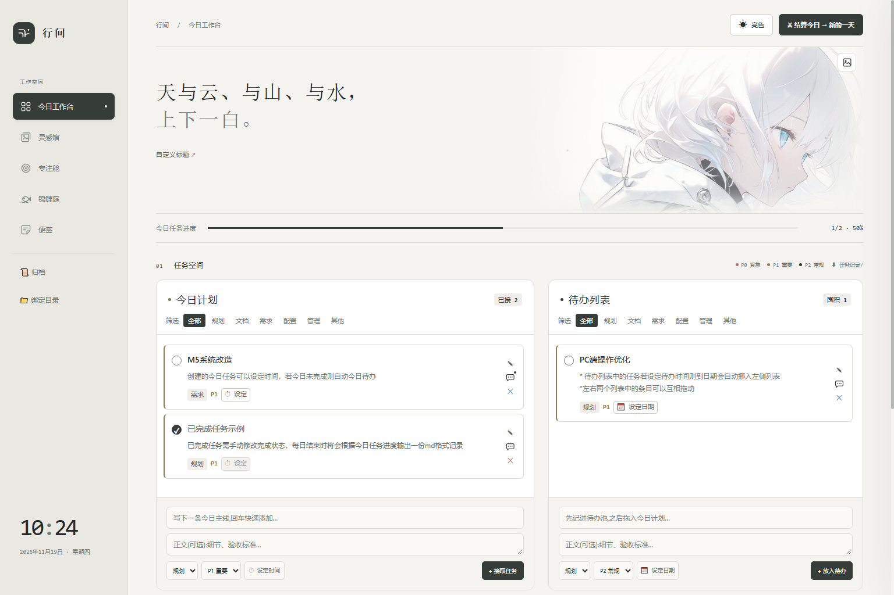

# 行间 · Between Lines

**一个在浏览器里运行的个人工作空间。** 最初是作为游戏策划的任务看板制作的，后来拓展了收集灵感、整理便签、专注计时等功能

<picture>
  <source media="(prefers-color-scheme: dark)" srcset="docs/dashboard-dark.png">
  
</picture>

## 开始使用

1. 下载并解压整个项目，保留 `行间.html`、`assets/` 和 `Banner/` 的相对位置。
2. 用 **浏览器** 打开 `行间.html`。不需要安装依赖、启动服务或登录。首次使用从空白工作台开始。
3. 想把每日记录写成文件，可在左侧「绑定目录」中选择自己创建的「任务记录」和「归档」文件夹。浏览器弹出授权时，确认位置后再允许写入。

## 五个空间

| 空间 | 用途 |
| --- | --- |
| 今日工作台 | 区分今日计划和待办，设置分类、优先级和时间；记录每日总结，将未完成事项顺延。在侧边栏选择绑定目录后会自动导出每日工作记录，方便后续复盘及整理。当月的会保存在目录中，之前月份的将归档。 |
| 灵感馆 | 收集文字、链接、截图和附件，按标签和整理状态检索；支持草稿、ZIP 备份，以及把已保存的卡片发送到 Obsidian。 |
| 专注舱 | 开始专注计时，可选环境声、沉浸全屏，并在结束时决定是否保存本轮。 |
| 锦鲤庭 | 观鱼、投喂、跟随呼吸、放叶，可切换天气与亮暗外观。 |
| 便签 | 在画布上书写、拖动和调整大小，可分组、隐藏、恢复，或将一个想法收录进灵感馆。 |

可以自行切换亮、暗两种主题，对应有不同的界面及独立Banner。点击首页 Banner 角落的图片图标，可选择内置素材、读取自选目录或上传图片。
## 发送到 Obsidian

打开一张已保存的灵感卡片，点击预览顶部的 **发送到 Obsidian**。首次请选择仓库里的一个子文件夹，例如「灵感收件箱」。每张卡片会生成一篇 Markdown，保留正文、来源、标签与日期；附件写入收件箱的 `_行间附件/` 子目录，并链接回笔记。

这是单向导出。再次发送同一卡片会提示，不会覆盖已经在 Obsidian 里编辑过的笔记。要更换收件箱，可在灵感馆的「保存与备份」中选择新目录。

## 本地数据与备份

- 任务、偏好和便签保存在当前浏览器；灵感与附件保存在 IndexedDB。没有应用账号或自动云同步。
- 想跨浏览器或跨设备使用，先在对应模块导出备份。灵感馆可导出 ZIP，便签可导出 JSON；任务支持每日 Markdown，绑定后也能写入任务状态备份。
- 目录写入由浏览器授权。若目录被移动、权限被收回或换了浏览器，需要重新选择。
- 页面可在本机运行。网络字体是可选资源，未加载时会回退到系统字体。
- 此仓库只应包含程序、公开素材和测试，不存放个人任务、任务记录、笔记库或备份。

## 项目结构

```text
index.html   页面入口与每日工作台
assets/      各模块、主题与内置图形
Banner/      亮暗默认横幅
docs/        README 预览图（使用空白工作台）
tests/       功能和数据格式测试
```

开发验证：在项目目录运行 `node --test`，建议使用 Node.js 24 或更高版本。安装 Python 3 并保证 `python` 命令可用时，测试还会额外验证 ZIP 能被标准工具读取。
